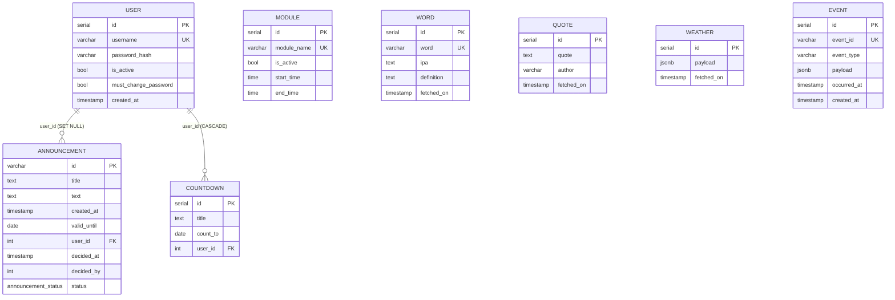

# Model danych i reguły domenowe

## Schemat bazy (PostgreSQL)

Źródło: `schema/schema.sql` + `schema/migrations/*.sql`. Brak narzędzia do migracji — pliki SQL uruchamia się ręcznie.

Migracje w `schema/migrations/`:

| Plik | Co robi |
|---|---|
| `weather_cache_001.sql` | Tabela `weather` (cache pogody). Zawarta w `schema.sql`. |
| `architecture_enhancements_001.sql` | Starsze bazy: `announcement.id` → `varchar`, `created_at date DEFAULT now()`, tabela `event`. |
| `event_store_001.sql` | Tabela `event` (dziennik zdarzeń). Zawarta w `schema.sql`. |
| `user_password_reset_001.sql` | Kolumna `user.must_change_password`. Zawarta w `schema.sql`. |

Nowa instalacja potrzebuje tylko `schema.sql`.

!!! warning "Aktualizacja istniejącej bazy"
    Bazy utworzone ze starego `schema.sql` mają w `announcement` kolumnę `date` (`NOT NULL`, bez wartości domyślnej), której kod już nie wypełnia, a żadna migracja jej nie usuwa — INSERT ogłoszenia kończy się wtedy błędem. Przed aktualizacją trzeba ręcznie usunąć kolumnę (`alter table announcement drop column date`) i uruchomić `event_store_001.sql` oraz `user_password_reset_001.sql`. Migracja `architecture_enhancements_001.sql` tworzy `created_at` jako `date`, więc godzina utworzenia nie jest zapisywana.



| Tabela | Ograniczenia i uwagi |
|---|---|
| `"user"` | `username` UNIQUE. `must_change_password` wymusza zmianę hasła po zalogowaniu. `is_active` nieużywane w kodzie. Nazwa wymaga cytowania (`user` to słowo zastrzeżone). |
| `announcement` | FK `user_id → user ON DELETE SET NULL`; CHECK: `decided_at` i `decided_by` oba null albo oba ustawione; CHECK `created_at::date <= valid_until`; `decided_by` bez FK. Status to natywny ENUM `announcement_status`. |
| `countdown` | FK `user_id → user ON DELETE CASCADE`. `count_to` ma typ `date` (bez godziny). |
| `module` | `module_name` UNIQUE; CHECK `start_time < end_time` (okna przez północ niemożliwe). |
| `word` | `word` UNIQUE — powtórzenie słowa w innym dniu powoduje błąd INSERT. |
| `quote` | – |
| `weather` | Cache odpowiedzi API pogody. Wiersze nigdy nie są usuwane. |
| `event` | Dziennik zdarzeń domenowych (append-only). |

Wymagane dane startowe w `module` — nazwy **w liczbie pojedynczej**, zgodne z enumem `ModuleName`:

```sql
insert into module (module_name, is_active, start_time, end_time) values
  ('announcement', true, '00:00', '23:59'),
  ('calendar',     true, '00:00', '23:59'),
  ('countdown',    true, '00:00', '23:59'),
  ('tram',         true, '00:00', '23:59'),
  ('weather',      true, '00:00', '23:59'),
  ('quote',        true, '00:00', '23:59'),
  ('word',         true, '00:00', '23:59');
```

## Konteksty domenowe

### Announcement (ogłoszenie)

| Pole | Typ | Uwagi |
|---|---|---|
| `id` | `AnnouncementId` | `uniqid('ann_', true)`, walidacja tylko prefiksu `ann_` |
| `title`, `text` | string | |
| `createdAt` | DateTimeImmutable | |
| `validUntil` | DateTimeImmutable | |
| `userId` | ?int | `null` dla propozycji anonimowych |
| `status` | `PENDING` / `APPROVED` / `REJECTED` | |
| `decidedAt`, `decidedBy` | ?DateTimeImmutable, ?int | |

Ścieżki tworzenia:

- `create()` — ogłoszenie dodane przez admina: od razu `APPROVED`, `decidedBy = autor`.
- `proposeNew()` — propozycja publiczna (`/propose`): `PENDING`, bez autora.

Przejścia: `approve()` → `APPROVED`, `reject()` → `REJECTED`. **Brak strażników** — każde przejście jest dozwolone (także APPROVED → REJECTED). `ApproveRejectAnnouncementUseCase` dla każdego statusu innego niż APPROVED wywołuje `reject()`.

Ważność: `status == APPROVED && now <= validUntil`.

Walidacja (`AnnouncementBusinessValidator`, wartości z `.env`):

| Reguła | Domyślnie |
|---|---|
| długość tytułu | 5–255 znaków |
| długość tekstu | 10–65535 znaków |
| `validUntil` | od teraz do `now + ANNOUNCEMENT_MAX_VALID_DATE` (`+1 year`) |

### Countdown (odliczanie)

Pola: `id`, `title`, `countTo` (data), `userId`.

- Tytuł niepusty, od `COUNTDOWN_MIN_TITLE_LENGTH` (3) do `COUNTDOWN_MAX_TITLE_LENGTH` (255) znaków.
- `countTo >= now` (z godziną — data „dziś” jest odrzucana).
- Na ekranie wyświetlane jest najbliższe przyszłe odliczanie (`count_to > now`, `LIMIT 1`).

### Module (moduł ekranu)

Pola: `id`, `moduleName` (`announcement | calendar | countdown | tram | weather | quote | word`), `isActive`, `startTime`, `endTime`.

Moduł jest widoczny, gdy `isActive && startTime <= now <= endTime` (porównanie godzin dnia bieżącego). Brak wiersza modułu w bazie → wyjątek `module.not_found` (404 w kopercie błędu na Display).

Operacje: `toggle()` i `updateSchedule(start, end)` (wymaga `start <= end`).

### User (użytkownik)

- `Username`: po trimie niepusty, maks. `MAX_USERNAME_LENGTH` (255), unikalny (duplikat → 409).
- `Password`: min. `MIN_PASSWORD_LENGTH` (8) znaków, bcrypt.
- Nieudane logowanie zawsze zwraca ten sam błąd 401 `auth.invalid_credentials`.
- Nie można usunąć samego siebie (403).
- Każdy zalogowany użytkownik może zmienić hasło innemu użytkownikowi; wtedy ustawiane jest `must_change_password = true` i przy następnym logowaniu `AuthMiddleware` przekierowuje go na `/change-password`. Zmiana własnego hasła zeruje flagę.

### Quote / Word (cytat i słowo dnia)

- Pobierane przez CLI (`quote:fetch`, `word:fetch`) raz dziennie; jeżeli rekord z dzisiejszą datą istnieje, komenda nic nie robi.
- Ekran pokazuje wyłącznie rekord z `fetched_on = dziś` — przed uruchomieniem crona moduł jest pusty.

### Weather (pogoda)

Cache odczytu (read-through) w tabeli `weather` z TTL `WEATHER_CACHE_TTL_SECONDS` (900 s). Szczegóły w [Integracjach](integrations.md#pogoda-imgw-airly).

## Zdarzenia domenowe

Encje zbierają zdarzenia, a use case po zapisie publikuje je przez `SyncEventPublisher` (do 3 prób z backoffem) do tabeli `event`. **Nie ma subskrybentów** — to wyłącznie dziennik audytowy.

| Agregat | Zdarzenia |
|---|---|
| Announcement | `announcement.created`, `.proposed`, `.approved`, `.rejected`, `.updated`, `.deleted` |
| Countdown | `countdown.created`, `.updated`, `.deleted` |
| Module | `module.toggled`, `module.updated` |
| Quote | `quote.created` |

Format wiersza: `{eventId: "evt_…", eventType, aggregateId, aggregateType, payload, occurredAt (UTC), version: 1}`.

Zapis danych i zdarzenia nie są w jednej transakcji — przy awarii zapisu zdarzenia dane są już zatwierdzone, a klient dostaje 500.

## Czas i strefy

- Wszystkie znaczniki czasu w bazie są „naiwne” (bez strefy) i liczone w domyślnej strefie PHP (`php.ini`). Wyjątek: `DomainEvent.occurredAt` w UTC.
- Formaty dat są konfigurowalne przez `.env` (`*_DATE_FORMAT`). Domyślne `Y-m-d` powoduje, że kolumny `timestamp` `user.created_at` i `quote/word.fetched_on` przechowują tylko datę. `announcement.created_at` i `decided_at` są zapisywane z godziną (format stały w `AnnouncementMapper`).
