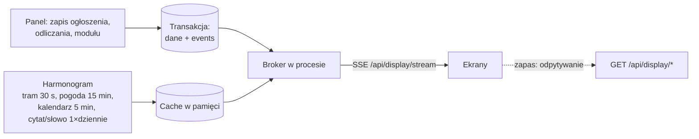

# Plan migracji na Pythona

## Historia zmian

| Wersja | Data | Zmiany |
|---|---|---|
| 2.4 | 2026-10-28 | Stan realizacji: etapy 0–5 zrobione lokalnie w `DoDomuDojade-v2` (czeka na utworzenie repozytorium); odstępstwa od planu. |
| 2.3 | 2026-10-28 | Przyjęte: Alpine.js, panel po polsku i angielsku, nazwa repozytorium `DoDomuDojade-v2`. |
| 2.2 | 2026-10-27 | Odpowiedzi twórcy na pytania otwarte: ekran na Raspberry Pi 4 z Firefoksem, serwer w szkole tylko w sieci wewnętrznej, start z czystą bazą (bez importu danych), osobne repozytorium w `SLOths4` z tą samą licencją, ekran bez zmian i tylko po polsku. Odjazdy autobusów i tramwajów ze wszystkich 8 słupków AWF. Cytat i słowo z projektów Wikimedia, na zmianę po polsku i angielsku. Frontend na Alpine.js zamiast Vue. |
| 2.1 | 2026-10-27 | Dostosowanie do nowego `main`: K1–K3 naprawione w PHP; import uwzględnia tabelę `event`, `must_change_password` i stare kolumny `announcement.date`; wymaganie wymuszonej zmiany hasła z blokadą innych akcji do czasu zmiany. |
| 2.0 | 2026-10-27 | Uwzględnione odpowiedzi twórcy: nowe repozytorium, przełączenie jednorazowe, bez dalszych prac nad PHP, ORM, Docker, uproszczona architektura, oddzielny frontend, SSE, przeprojektowany panel, role, tramwaje z GTFS/GTFS-RT, nowe źródła cytatu i słowa dnia, wymagania dla edycji ogłoszeń. |
| 1.0 | 2026-10-27 | Pierwsze wydanie: wstępny plan migracji na podstawie analizy kodu. |

## Stan realizacji (2026-10-28)

Kod nowej wersji powstał lokalnie i czeka na utworzenie repozytorium `SLOths4/DoDomuDojade-v2`.

| Etap | Stan |
|---|---|
| 0 — fundamenty | gotowe: Docker Compose, `ddd`, FastAPI, Alembic, Caddy, CI |
| 1 — rdzeń backendu | gotowe: logowanie, sesje, CSRF, limit prób, role, wymuszona zmiana hasła, API ogłoszeń/odliczań/modułów/użytkowników, zdarzenia, harmonogram |
| 2 — integracje | gotowe: odjazdy z GTFS + GTFS-RT (8 słupków AWF, autobusy i tramwaje), IMGW + Airly, Google Calendar, cytat i słowo z Wikimedia (pl/en na zmianę) z lokalnym zapasem |
| 3 — ekran | gotowe: API ekranu, strumień SSE, ekran w dotychczasowym układzie z ponownym łączeniem i przeładowaniem po awarii |
| 4 — panel | gotowe: przeprojektowany panel (pl/en), formularz propozycji |
| 5 — przełączenie | przygotowane: `DEPLOY.md` z listą kontrolną i planem powrotu; samo wdrożenie wymaga serwera szkolnego |

Sprawdzone: 83 testy backendu (w tym na PostgreSQL), lint i typy, pełna instalacja od zera w Dockerze, ręczne testy ekranu i panelu w przeglądarce (także restart API przy otwartym ekranie). Niesprawdzone na żywo: Airly i Google Calendar (brak kluczy — parsowanie pokryte testami), Raspberry Pi.

Odstępstwa od planu:

- Moduł odjazdów nazywa się `departures` zamiast `tram` (obejmuje autobusy).
- SSE nie odtwarza historii zdarzeń po ponownym połączeniu — ekran dostaje po prostu pełny stan. Prostsze, a efekt ten sam; tabela `events` zostaje jako dziennik zmian.
- Okno modułu `od = do` oznacza cały dzień; nowe moduły domyślnie są widoczne cały dzień.
- Brak osobnej ochrony „ostatniego administratora” — admin nie może zmienić własnej roli ani usunąć siebie, co wystarcza.
- Godziny w API są w strefie Europe/Warsaw.

## Cel i zasady

Nowa wersja DoDomuDojadę powstaje w Pythonie, w **nowym repozytorium**. Obecne repozytorium zostanie zarchiwizowane po przełączeniu. Kod PHP nie jest już rozwijany ani naprawiany — opisane w [Stanie projektu](current-state.md) błędy służą jako lista wymagań dla nowej wersji.

1. **Ultra prosty start.** `git clone`, `cp .env.example .env`, `docker compose up` — i działa. Bez ręcznego tworzenia bazy, crona ani budowania frontendu.
2. **Prosta architektura.** Moduły per funkcja zamiast czterech warstw DDD, interfejsów repozytoriów i własnego kontenera DI.
3. **Frontend oddzielony od backendu.** Backend to wyłącznie JSON API, frontend to osobny katalog ze statycznymi stronami HTML i komponentami Alpine.js, serwowany przez Caddy.
4. **Ekran na żywo.** Ekran dostaje zmiany przez SSE zamiast odpytywać serwer co kilka sekund.
5. **Przełączenie jednorazowe.** Nowa wersja jest budowana i testowana obok starej (z prawdziwą konfiguracją, na ekranie testowym), a na produkcję trafia w całości, gdy wszystko działa.

## Decyzje

| # | Temat | Decyzja | Status |
|---|---|---|---|
| D1 | Repozytorium | Nowe repozytorium; obecne zarchiwizowane po przełączeniu. | przyjęte |
| D2 | Przełączenie | Jednorazowe, po pełnych testach z prawdziwą konfiguracją. | przyjęte |
| D3 | Prace nad PHP | Brak. Priorytetem jest migracja. | przyjęte |
| D4 | Dostęp do bazy | SQLAlchemy 2 ORM (zespół go zna). | przyjęte |
| D5 | Konfiguracja | Nazwy tabel i formaty dat jako stałe w kodzie; w `.env` tylko sekrety, adresy i ustawienia wdrożenia. | przyjęte |
| D6 | Uruchamianie | Docker Compose. | przyjęte |
| D7 | Architektura | Uproszczona: moduły per funkcja. | przyjęte |
| D8 | Frontend | Oddzielny od backendu. | przyjęte |
| D9 | Ekran | SSE, z odpytywaniem jako zapasem. | przyjęte |
| D10 | Panel | Przeprojektowany: spójny wygląd i zachowanie, przyjazny dla użytkownika. | przyjęte |
| D11 | Tramwaje | Oficjalne dane ZTM: GTFS + GTFS-RT zamiast `method.vm`. | przyjęte |
| D12 | CLI | Uproszczone, jeden skrypt `ddd`. | przyjęte |
| D13 | Role | Admin i moderator od początku; logowanie Google w późniejszym etapie. | przyjęte |
| D14 | Framework frontendu | **Alpine.js + Tailwind CSS 4, bez frameworka SPA i bez bundlera.** Zespół zna Alpine, kod ekranu w dużej części przechodzi bez zmian, uczniom łatwiej to utrzymać. | przyjęte |
| D15 | Cytat i słowo dnia | Projekty Wikimedia, na zmianę: jeden dzień po polsku, następny po angielsku. | przyjęte |
| D16 | Odjazdy | Autobusy i tramwaje ze wszystkich słupków przystanku AWF (8 słupków w GTFS). | przyjęte |
| D17 | Logowanie Google | Domena Google Workspace szkoły i domyślna rola nowych kont. | do decyzji (etap późniejszy) |
| D19 | Dane ze starej wersji | Nie są przenoszone: baza nie zawiera istotnych danych. Przenoszona jest tylko konfiguracja (klucze API, konto serwisowe Google, id kalendarza). | przyjęte |
| D20 | Repozytorium | **`SLOths4/DoDomuDojade-v2`**, licencja CC BY-NC 4.0 jak dotąd. Po przełączeniu stare repozytorium można przemianować na `DoDomuDojade-php` i zarchiwizować. Fork odpada: GitHub nie pozwala forkować do tej samej organizacji. | przyjęte |
| D21 | Ekran | Wygląd bez zmian. Tylko po polsku. | przyjęte |
| D22 | Język panelu | Panel po polsku i po angielsku, jak dziś. Język z wyboru użytkownika (zapamiętany w profilu), a domyślnie z języka przeglądarki. Ekran tylko po polsku (D21). | przyjęte |
| D23 | Kopie zapasowe | Bez automatycznych kopii: brak istotnych danych. `ddd backup` jako prosta komenda na żądanie. | przyjęte |
| D18 | Hosting | Serwer w szkole, dostępny tylko w sieci wewnętrznej; utrzymują go uczniowie lub informatyk. | przyjęte |

## Stos

| Obszar | Wybór |
|---|---|
| Język | Python 3.13, zarządzanie przez **uv** |
| API | **FastAPI** + uvicorn |
| Baza | PostgreSQL 17, **SQLAlchemy 2 ORM**, psycopg 3, **Alembic** |
| Walidacja i konfiguracja | Pydantic 2, pydantic-settings |
| Zadania cykliczne | **APScheduler** w procesie aplikacji (zamiast crona) |
| HTTP klient | httpx (timeouty, ponowienia) |
| Tramwaje | `gtfs-realtime-bindings` (protobuf) |
| Kalendarz | google-api-python-client + google-auth |
| Hasła | bcrypt (czyta istniejące hashe `$2y$`) |
| Logowanie Google (później) | Authlib (OpenID Connect) |
| CLI | Typer |
| Frontend | Alpine.js (przypięta wersja w repozytorium, nie z CDN), Tailwind CSS 4, moduły ES bez bundlera (D14) |
| Serwer WWW | **Caddy** (pliki statyczne frontendu + proxy do API) |
| Jakość | pytest, ruff, mypy; GitHub Actions |
| Uruchamianie | Docker Compose |

## Struktura nowego repozytorium

```
DoDomuDojade-v2/
├── docker-compose.yml        # db, api, web
├── .env.example
├── ddd                       # skrypt CLI (bash) — patrz niżej
├── backend/
│   ├── Dockerfile
│   ├── pyproject.toml
│   ├── alembic/
│   ├── data/                 # quotes.json, words.json (zapasowe źródła)
│   └── app/
│       ├── main.py           # FastAPI, routery, start harmonogramu
│       ├── core/
│       │   ├── config.py     # Settings
│       │   ├── db.py         # silnik, sesja, Base
│       │   ├── auth.py       # sesja, CSRF, current_user, role
│       │   ├── errors.py     # koperta błędu
│       │   ├── i18n.py       # tłumaczenia komunikatów API (pl, en)
│       │   ├── events.py     # zapis zdarzeń + broker SSE
│       │   └── scheduler.py  # zadania cykliczne
│       ├── announcements/    # models.py, schemas.py, service.py, router.py
│       ├── countdowns/
│       ├── modules/
│       ├── users/
│       ├── display/          # endpointy ekranu + strumień SSE
│       ├── integrations/
│       │   ├── tram.py       # GTFS + GTFS-RT
│       │   ├── weather.py    # IMGW + Airly
│       │   ├── calendar.py
│       │   ├── quote.py      # łańcuch źródeł
│       │   └── word.py
│       └── cli.py
└── frontend/
    ├── Dockerfile            # build Tailwind → obraz Caddy
    ├── Caddyfile
    ├── display/              # index.html + display.js (ekran)
    ├── panel/                # strony panelu (HTML) + ich komponenty Alpine (.js)
    └── shared/               # api.js (klient API, CSRF), i18n.js + locales/pl.json, en.json, komponenty, style, alpine.min.js
```

Każdy moduł funkcji ma te same cztery pliki: `models.py` (tabele ORM), `schemas.py` (Pydantic: wejście i wyjście API), `service.py` (logika i reguły), `router.py` (endpointy). Nie ma interfejsów repozytoriów, use case'ów w osobnych klasach ani kontenera DI — wystarczy `Depends()`.

## Uruchamianie (Docker)

```yaml
services:
  db:   postgres:17, wolumen na dane, healthcheck
  api:  backend; przy starcie `alembic upgrade head`, potem uvicorn
  web:  Caddy z gotowym frontendem; /api/* → api:8000
```

Start od zera:

```bash
cp .env.example .env
./ddd up
./ddd user add admin
```

Migracje bazy uruchamiają się same przy starcie kontenera `api`. Dane startowe (wiersze modułów) dodaje migracja Alembic. Zadania cykliczne działają w procesie API, więc nie trzeba konfigurować crona.

## CLI: skrypt `ddd`

Jeden skrypt w bashu w katalogu głównym, który przekazuje polecenia do kontenera (`docker compose exec api python -m app.cli …`).

| Polecenie | Działanie |
|---|---|
| `ddd up` / `ddd down` | Start / zatrzymanie całości. |
| `ddd logs` | Logi aplikacji. |
| `ddd fetch` | Natychmiastowe pobranie cytatu, słowa, pogody i rozkładu (normalnie robi to harmonogram). |
| `ddd user add <login>` | Nowy użytkownik; hasło pytane interaktywnie, rola `--role admin|moderator`. |
| `ddd cleanup` | Usunięcie starych odrzuconych ogłoszeń i starych wpisów cache pogody. |
| `ddd migrate` | Migracje bazy (normalnie automatyczne). |
| `ddd backup` | Zrzut bazy do pliku w `./backups` (na żądanie). |

Polecenia kończą się kodem różnym od 0 przy błędzie.

## API

Wszystkie endpointy są pod `/api`. Frontend i API działają w jednej domenie (Caddy), więc logowanie opiera się na ciasteczku sesji.

| Grupa | Endpointy |
|---|---|
| Auth | `POST /api/auth/login`, `POST /api/auth/logout`, `GET /api/auth/me` |
| Ekran | `GET /api/display/{departures,weather,announcements,countdown,events,quote,word}`, `GET /api/display/stream` (SSE) |
| Propozycje | `POST /api/announcements/proposals` (publiczne) |
| Panel | CRUD `/api/announcements`, `/api/countdowns`, `/api/modules`, `/api/users`; `POST /api/announcements/{id}/approve`, `…/reject` |
| Konfiguracja | `GET /api/config` — limity długości pól itp. dla formularzy |

Ponieważ frontend też jest pisany od nowa, kontrakt może zostać uporządkowany (liczba mnoga w ścieżkach, spójne `camelCase` w JSON). Koperta odpowiedzi ekranu `{status, data, message}` i koperta błędu `{status: "error", data: {code, context}, message}` zostają, bo się sprawdziły.

Bezpieczeństwo:

- Ciasteczko sesji `HttpOnly`, `SameSite=Lax` (oraz `Secure`, gdy działa HTTPS); bez wiązania z adresem IP.
- Serwer jest dostępny tylko w sieci szkolnej. Na start wystarczy HTTP w sieci wewnętrznej; HTTPS przez Caddy z certyfikatem wewnętrznym albo z prawdziwej domeny (wyzwanie DNS), gdy dojdzie logowanie Google.
- CSRF: token w nagłówku `X-CSRF-Token` dla metod zmieniających stan.
- Niezalogowane wywołanie API → **401** w JSON (nie przekierowanie).
- Limit prób logowania.

## Role

| Uprawnienie | Moderator | Admin |
|---|---|---|
| Ogłoszenia: dodawanie, edycja, zatwierdzanie, odrzucanie, usuwanie | tak | tak |
| Odliczania | tak | tak |
| Moduły ekranu (włączanie, godziny) | nie | tak |
| Użytkownicy i role | nie | tak |

Kolumna `role` w tabeli `users` od początku.

Wymuszona zmiana hasła (`must_change_password`, wprowadzona w PHP w październiku 2026) zostaje: konto z tą flagą może wyłącznie zmienić własne hasło i się wylogować — w PHP może dziś zarządzać innymi użytkownikami (B19 w [Stanie projektu](current-state.md)). Zmiana hasła innej osobie wymaga roli admin i ustawia jej tę flagę. Logowanie Google (późniejszy etap): OpenID Connect przez Authlib, dostęp tylko dla kont z domeny szkoły (`hd`), konto tworzone automatycznie przy pierwszym logowaniu z rolą domyślną (D17).

Logowanie Google **nie wymaga wystawienia serwera do internetu**. Google nie łączy się z serwerem: przekierowanie na adres zwrotny (callback) robi przeglądarka użytkownika, a serwer sam wysyła zapytanie do Google. Google wymaga jednak, żeby adres zwrotny był domeną z publiczną końcówką (np. `ekran.szkola.pl`), a nie adresem IP — wystarczy, że ta domena rozwiązuje się na serwer w sieci szkolnej. Logowanie nauczycieli spoza szkoły wymagałoby już udostępnienia serwera na zewnątrz.

## Ekran na żywo (SSE)



- Po połączeniu ekran dostaje pełny stan (wszystkie moduły), potem tylko zmiany: `event: departures`, `event: announcements`, `event: module` itd.
- Zmiany z panelu zapisują się w tabeli `events` **w tej samej transakcji** co dane. Po zatwierdzeniu broker rozsyła je do ekranów. `events.id` służy jako `id:` w SSE, więc po zerwaniu połączenia ekran podaje `Last-Event-ID` i dostaje to, co przegapił.
- Dane zewnętrzne pobiera harmonogram w tle i trzyma w pamięci. Liczba ekranów nie wpływa na liczbę zapytań do ZTM, Google i Airly.
- Widoczność modułów (godziny) sprawdza harmonogram co minutę i wysyła zmianę, gdy moduł się włącza lub wyłącza.
- Jeden proces uvicorn wystarczy dla tej skali. Przy kilku procesach broker przechodzi na PostgreSQL `LISTEN/NOTIFY`.
- Caddy: wyłączone buforowanie dla `/api/display/stream`.
- Gdy SSE nie działa, frontend wraca do odpytywania endpointów `/api/display/*`.

## Integracje

### Tramwaje: GTFS + GTFS-RT ZTM Poznań

Źródła (bez klucza API, dane bezpłatne):

| Dane | Adres | Odświeżanie |
|---|---|---|
| Rozkład (GTFS ZIP, ~11 MB) | `https://www.ztm.poznan.pl/pl/dla-deweloperow/getGTFSFile` | raz dziennie (~03:00) i przy starcie |
| Opóźnienia (GTFS-RT, protobuf) | `https://www.ztm.poznan.pl/pl/dla-deweloperow/getGtfsRtFile/?file=trip_updates.pb` | co 30 s, jeden poller |

Warunki ZTM: podać źródło i datę aktualizacji danych, nie używać logo ZTM ani Poznania. Dokumentacja: [otwarte dane ZTM](https://www.ztm.poznan.pl/otwarte-dane/).

Najważniejsze fakty (sprawdzone na danych z 2026-10-27):

- `stops.txt` ma kolumnę `stop_code` z symbolami PEKA (`AWF41` → `stop_id 172`). Przystanek AWF ma 8 słupków o nazwie `AWF`: `AWF01`–`AWF05`, `AWF41`, `AWF42`, `AWF73` (stan na 2026-10-27). Konfiguracja: `STOP_NAME=AWF` wybiera wszystkie słupki o tej nazwie, więc nowy słupek pojawi się sam; opcjonalnie `STOP_CODES` do zawężenia.
- `calendar_dates.txt` jest pusty, ale kod musi go obsłużyć.
- Godziny po północy zapisane są jako `24:02:00` itd.
- TripUpdates mają po jednym `stop_time_update` na kurs, tylko z `arrival.delay` — opóźnienie trzeba przenieść na dalsze przystanki.
- `trip_id` z RT pasują 1:1 do `trips.txt`.

Algorytm:

1. Z GTFS wczytać: słupki o nazwie `STOP_NAME` (`stop_name → [stop_id]`), `trips`, `routes`, `calendar`, `calendar_dates` i `stop_times` tylko dla skonfigurowanych przystanków.
2. Aktywne usługi dla dwóch dni serwisowych: dziś i wczoraj (kursy po północy). Czas odjazdu = `północ dnia serwisowego (Europe/Warsaw) + sekundy z stop_times`.
3. Kandydaci z oknem `[teraz − 2 min, teraz + 90 min]`, bez przystanków tylko wysiadkowych (`pickup_type = 1`).
4. Opóźnienie z RT: jeśli kurs jest w RT i jego bieżący `stop_sequence ≤` sekwencji przystanku → czas + opóźnienie; jeśli pojazd już minął przystanek → pomiń; brak w RT → czas rozkładowy.
5. Wynik `{stopCode, line, minutes, direction, realtime}`, posortowany po minutach, autobusy i tramwaje (D16). Z `stop_headsign` usunąć znak `!` (oznaczenie objazdu).

Zapas: RT starszy niż 3 min → czasy rozkładowe; brak GTFS → `status: empty`.

### Cytat i słowo dnia

Obecne źródło cytatów nie działa (`quotes-api-self.vercel.app` zwraca `DEPLOYMENT_NOT_FOUND`), a słowo dnia pochodzi z prywatnego serwisu bez gwarancji. Nowa wersja korzysta z projektów Wikimedia (D15): darmowe, stabilne, bez klucza API.

Język zmienia się co dzień: dni o parzystym numerze (`data.toordinal() % 2 == 0`) po polsku, nieparzyste po angielsku. Cytat i słowo danego dnia są w tym samym języku.

| | Po polsku | Po angielsku |
|---|---|---|
| Cytat | Wikicytaty: `pl.wikiquote.org`, strona `Szablon:Cytat_dnia/{dzień}_{miesiąc w dopełniaczu}` (np. `27_października`). Tekst między `'''''…'''''`, autor z `[[…]]`. | Wikiquote: `en.wikiquote.org`, strona `Wikiquote:Quote_of_the_day/{Month}_{D},_{YYYY}` (np. `October_27,_2026`). Parametry szablonu `quote=` i `author=`. |
| Słowo | Wikisłownik: `pl.wiktionary.org`, strona `Wikisłownik:Słowo_dnia/Rozkład/YYYY/MM/DD`. Parametry `hasło`, `wymowa` (`{{IPA|…}}`), pierwsza definicja `(1.1)` ze `znaczenie`. | Wiktionary: `en.wiktionary.org`, strona `Wiktionary:Word_of_the_day/YYYY/Month_D`. Szablon `{{WOTD|słowo|część mowy|definicja}}`; wymowa z `api.dictionaryapi.dev/api/v2/entries/en/{słowo}` (`[0].phonetic`), jeśli jest. |
| Zapas | lokalny `data/quotes_pl.json`, `data/words_pl.json` | lokalny `data/quotes_en.json`, `data/words_en.json` |

Wszystkie strony pobierane są przez `index.php?title=…&action=raw` (sprawdzone 2026-10-27, odpowiedź 200). Wymagania Wikimedia: nagłówek `User-Agent` z nazwą aplikacji i adresem kontaktowym. Licencja CC BY-SA: na ekranie mały podpis źródła („Wikicytaty”, „Wikisłownik”, „Wikiquote”, „Wiktionary”). Wikitekst czyścić biblioteką `mwparserfromhell`.

Lokalne listy (~366 pozycji na język) wybierane są według daty i działają bez sieci.

### Pogoda (IMGW + Airly)

Bez zmian w źródłach. Poprawki: wartości Airly szukane po nazwie (`PM25`, `PRESSURE`…), nie po pozycji; cache w pamięci zamiast tabeli rosnącej bez końca (ostatni wynik zapisany w bazie na wypadek restartu).

### Kalendarz Google

Bez zmian w źródle. Poprawki: wydarzenia całodniowe (`start.date` zamiast `start.dateTime`) wyświetlane jako „Cały dzień”; cache 5 min.

## Panel administracyjny — wymagania

Ogólne:

- Jeden zestaw komponentów (tabela, formularz, okno potwierdzenia, komunikat) używany na każdej stronie.
- Formularz po błędzie zostaje otwarty z wpisanymi danymi; błędy pokazane przy polach.
- Limity pól pobierane z `GET /api/config` — jedno źródło prawdy dla frontendu i backendu.
- Wygaśnięcie sesji → przekierowanie na logowanie z powrotem na tę samą stronę.
- Działanie na telefonie.
- Dwa języki (D22): wszystkie teksty panelu w `frontend/shared/locales/{pl,en}.json`, komunikaty błędów API tłumaczone po kluczu (jak dziś w `resources/lang`). Przełącznik języka w profilu; wybór zapisany przy koncie (kolumna `users.locale`).

Ogłoszenia (na podstawie analizy obecnych błędów edycji):

| Problem w PHP | Wymaganie w Pythonie |
|---|---|
| Całe API ogłoszeń zwraca 500 (walidator nie powstaje w kontenerze). | Test każdego endpointu w CI. |
| Dzisiejsza data ważności jest odrzucana; nie da się poprawić tekstu wygasłego ogłoszenia. | `valid_until >= dziś`; data walidowana tylko, gdy się zmienia. |
| Pusta lub błędna data, brak pola → 500. | Walidacja Pydantic → 400 z błędem przy polu. |
| Zmiana statusu w edycji omija zatwierdzanie i zostawia `decided_by` przy statusie PENDING. | Status zmieniany wyłącznie akcjami zatwierdź/odrzuć; powrót do PENDING czyści `decided_*`. |
| `decided_at` traci godzinę. | Kolumny `timestamptz`. |
| Dane zapisane, a użytkownik widzi błąd (zdarzenie zapisywane osobno). | Dane i zdarzenie w jednej transakcji. |
| Limity frontendu (50/500) inne niż backendu (5–255 / 10–65535). | Limity z `/api/config`. |
| Modal zamyka się przy błędzie, zmiany giną. | Zamykanie tylko po sukcesie. |
| Brak trim tytułu i tekstu przy edycji. | Trim we wszystkich ścieżkach. |

## Model danych

Nowy, uporządkowany schemat tworzony przez Alembic:

| Tabela | Zmiany względem obecnej bazy |
|---|---|
| `users` | + `role` (`admin`/`moderator`), + `locale` (`pl`/`en`), + `google_sub` (później); `timestamptz`. |
| `announcements` | bez kolumny `date`; `created_at`, `decided_at` jako `timestamptz`; `decided_by` z kluczem obcym; status jako `text` z CHECK. |
| `countdowns` | `count_to` jako `timestamptz` (z godziną). |
| `modules` | okna czasowe mogą przechodzić przez północ (`start_time > end_time` oznacza noc). |
| `quotes`, `words` | `fetched_on` jako `date`; bez UNIQUE na samym słowie (UNIQUE na dacie). |
| `weather` | jeden wiersz z ostatnim wynikiem zamiast historii. |
| `events` | `id bigserial` (numer zdarzenia dla SSE), `type`, `payload jsonb`, `created_at`. |

Danych ze starej bazy nie przenosimy (D19). Nowa instalacja startuje z pustą bazą; konta tworzy się przez `ddd user add`. Ze starego serwera przenoszona jest tylko konfiguracja: klucz Airly, plik konta serwisowego Google i id kalendarza (do pobrania z obecnego serwera, np. przez tunel SSH).

## Etapy

### Etap 0 — fundamenty

- [ ] Nowe repozytorium, `docker-compose.yml`, skrypt `ddd`, CI (ruff, mypy, pytest, build frontendu).
- [ ] Szkielet FastAPI, konfiguracja, baza, Alembic, koperta błędu.
- [ ] Szkielet frontendu (Vite) i Caddy.

### Etap 1 — rdzeń backendu

- [ ] Użytkownicy, role, logowanie, sesja, CSRF, limit prób.
- [ ] Ogłoszenia, odliczania, moduły — API z wymaganiami z sekcji panelu.
- [ ] Zdarzenia w transakcji, broker, harmonogram.

### Etap 2 — integracje

- [ ] Tramwaje (GTFS + GTFS-RT) z testami na zapisanych plikach feedu.
- [ ] Pogoda, kalendarz, cytat, słowo — z łańcuchami źródeł i timeoutami.

### Etap 3 — ekran

- [ ] Endpointy `/api/display/*` i strumień SSE.
- [ ] Frontend ekranu (obecny układ bez zmian, SSE z zapasowym odpytywaniem), test na Raspberry Pi 4 z Firefoksem.

### Etap 4 — panel

- [ ] Projekt panelu (spójne komponenty), potem implementacja stron: ogłoszenia, propozycje, odliczania, moduły, użytkownicy.

### Etap 5 — przełączenie

- [ ] Przeniesienie konfiguracji (klucze, konto serwisowe Google) z obecnego serwera.
- [ ] Utworzenie kont, ustawienie modułów, testy na ekranie Raspberry Pi.
- [ ] Wdrożenie na serwer szkolny, przełączenie adresu, który otwiera Firefox na ekranie; obserwacja.
- [ ] Archiwizacja starego repozytorium.

### Później

- [ ] Logowanie Google dla nauczycieli (D17).

## Na co uważać

| Temat | Szczegół |
|---|---|
| Ekran | Raspberry Pi 4 z Firefoksem w trybie bez interfejsu. Unikać ciężkich animacji; SSE musi samo wznawiać połączenie po restarcie serwera lub zerwaniu sieci, a strona przeładować się po dłuższej awarii — nikt nie kliknie „odśwież”. |
| Sesje | Po przełączeniu wszyscy logują się ponownie, a konta trzeba utworzyć od nowa. |
| Strefa czasowa | Wszystko w `Europe/Warsaw` dla logiki, `timestamptz` w bazie. |
| ZTM | Format danych może się zmienić bez uprzedzenia — testy na zapisanych feedach i czytelne logi przy błędzie parsowania. |
| Wikimedia | Strony dnia bywają uzupełniane z wyprzedzeniem, ale nie zawsze — zawsze mieć lokalny zapas. |
