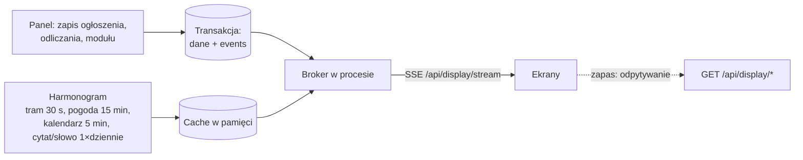

# Plan migracji na Pythona

## Historia zmian

| Wersja | Data | Zmiany |
|---|---|---|
| 2.1 | 2026-10-27 | Dostosowanie do nowego `main`: K1–K3 naprawione w PHP; import uwzględnia tabelę `event`, `must_change_password` i stare kolumny `announcement.date`; wymaganie wymuszonej zmiany hasła z blokadą innych akcji do czasu zmiany. |
| 2.0 | 2026-10-27 | Uwzględnione odpowiedzi twórcy: nowe repozytorium, przełączenie jednorazowe, bez dalszych prac nad PHP, ORM, Docker, uproszczona architektura, oddzielny frontend, SSE, przeprojektowany panel, role, tramwaje z GTFS/GTFS-RT, nowe źródła cytatu i słowa dnia, wymagania dla edycji ogłoszeń. |
| 1.0 | 2026-10-27 | Pierwsze wydanie: wstępny plan migracji na podstawie analizy kodu. |

## Cel i zasady

Nowa wersja DoDomuDojadę powstaje w Pythonie, w **nowym repozytorium**. Obecne repozytorium zostanie zarchiwizowane po przełączeniu. Kod PHP nie jest już rozwijany ani naprawiany — opisane w [Stanie projektu](current-state.md) błędy służą jako lista wymagań dla nowej wersji.

1. **Ultra prosty start.** `git clone`, `cp .env.example .env`, `docker compose up` — i działa. Bez ręcznego tworzenia bazy, crona ani budowania frontendu.
2. **Prosta architektura.** Moduły per funkcja zamiast czterech warstw DDD, interfejsów repozytoriów i własnego kontenera DI.
3. **Frontend oddzielony od backendu.** Backend to wyłącznie JSON API, frontend to osobna aplikacja budowana do plików statycznych.
4. **Ekran na żywo.** Ekran dostaje zmiany przez SSE zamiast odpytywać serwer co kilka sekund.
5. **Przełączenie jednorazowe.** Nowa wersja jest budowana i testowana obok starej (na kopii danych), a na produkcję trafia w całości, gdy wszystko działa.

## Decyzje

| # | Temat | Decyzja | Status |
|---|---|---|---|
| D1 | Repozytorium | Nowe repozytorium; obecne zarchiwizowane po przełączeniu. | przyjęte |
| D2 | Przełączenie | Jednorazowe, po pełnych testach na kopii danych. | przyjęte |
| D3 | Prace nad PHP | Brak. Priorytetem jest migracja. | przyjęte |
| D4 | Dostęp do bazy | SQLAlchemy 2 ORM (zespół go zna). | przyjęte |
| D5 | Konfiguracja | Nazwy tabel i formaty dat jako stałe w kodzie; w `.env` tylko sekrety, adresy i ustawienia wdrożenia. | przyjęte |
| D6 | Uruchamianie | Docker Compose. | przyjęte |
| D7 | Architektura | Uproszczona: moduły per funkcja. | przyjęte |
| D8 | Frontend | Oddzielny od backendu. | przyjęte |
| D9 | Ekran | SSE, z odpytywaniem jako zapasem. | przyjęte |
| D10 | Panel | Przeprojektowany: spójny wygląd i zachowanie, przyjazny dla użytkownika. | przyjęte |
| D11 | Tramwaje | Oficjalne dane ZTM: GTFS + GTFS-RT zamiast `method.vm`. | przyjęte |
| D12 | CLI | Uproszczone, jeden skrypt `ddd`. | przyjęte |
| D13 | Role | Admin i moderator od początku; logowanie Google w późniejszym etapie. | przyjęte |
| D14 | Framework frontendu | Propozycja: **Vue 3 + Vite + TypeScript + Tailwind 4**. Składnia Vue jest bardzo bliska Alpine.js, a komponenty ułatwią spójny panel. | do potwierdzenia |
| D15 | Język cytatu i słowa dnia | Polski (Wikicytaty, Wikisłownik) czy angielski (ZenQuotes, wotd.site)? | do decyzji |
| D16 | Linie na ekranie | Tylko tramwaje czy wszystkie linie z przystanków (jak dziś)? | do decyzji |
| D17 | Logowanie Google | Domena Google Workspace szkoły i domyślna rola nowych kont. | do decyzji (etap późniejszy) |
| D18 | Hosting | Serwer z Dockerem — gdzie i kto nim zarządza? | do decyzji |

## Stos

| Obszar | Wybór |
|---|---|
| Język | Python 3.13, zarządzanie przez **uv** |
| API | **FastAPI** + uvicorn |
| Baza | PostgreSQL 17, **SQLAlchemy 2 ORM**, psycopg 3, **Alembic** |
| Walidacja i konfiguracja | Pydantic 2, pydantic-settings |
| Zadania cykliczne | **APScheduler** w procesie aplikacji (zamiast crona) |
| HTTP klient | httpx (timeouty, ponowienia) |
| Tramwaje | `gtfs-realtime-bindings` (protobuf) |
| Kalendarz | google-api-python-client + google-auth |
| Hasła | bcrypt (czyta istniejące hashe `$2y$`) |
| Logowanie Google (później) | Authlib (OpenID Connect) |
| CLI | Typer |
| Frontend | Vue 3, Vite, TypeScript, Tailwind CSS 4 (D14) |
| Serwer WWW | **Caddy** (pliki statyczne frontendu + proxy do API, HTTPS automatycznie) |
| Jakość | pytest, ruff, mypy; Vitest dla frontendu; GitHub Actions |
| Uruchamianie | Docker Compose |

## Struktura nowego repozytorium

```
ddd/
├── docker-compose.yml        # db, api, web
├── .env.example
├── ddd                       # skrypt CLI (bash) — patrz niżej
├── backend/
│   ├── Dockerfile
│   ├── pyproject.toml
│   ├── alembic/
│   ├── data/                 # quotes.json, words.json (zapasowe źródła)
│   └── app/
│       ├── main.py           # FastAPI, routery, start harmonogramu
│       ├── core/
│       │   ├── config.py     # Settings
│       │   ├── db.py         # silnik, sesja, Base
│       │   ├── auth.py       # sesja, CSRF, current_user, role
│       │   ├── errors.py     # koperta błędu
│       │   ├── events.py     # zapis zdarzeń + broker SSE
│       │   └── scheduler.py  # zadania cykliczne
│       ├── announcements/    # models.py, schemas.py, service.py, router.py
│       ├── countdowns/
│       ├── modules/
│       ├── users/
│       ├── display/          # endpointy ekranu + strumień SSE
│       ├── integrations/
│       │   ├── tram.py       # GTFS + GTFS-RT
│       │   ├── weather.py    # IMGW + Airly
│       │   ├── calendar.py
│       │   ├── quote.py      # łańcuch źródeł
│       │   └── word.py
│       ├── cli.py
│       └── legacy_import.py  # jednorazowy import danych ze starej bazy
└── frontend/
    ├── Dockerfile            # build Vite → Caddy
    ├── Caddyfile
    └── src/
        ├── display/          # ekran
        ├── panel/            # panel administracyjny
        └── shared/           # klient API, komponenty, style
```

Każdy moduł funkcji ma te same cztery pliki: `models.py` (tabele ORM), `schemas.py` (Pydantic: wejście i wyjście API), `service.py` (logika i reguły), `router.py` (endpointy). Nie ma interfejsów repozytoriów, use case'ów w osobnych klasach ani kontenera DI — wystarczy `Depends()`.

## Uruchamianie (Docker)

```yaml
services:
  db:   postgres:17, wolumen na dane, healthcheck
  api:  backend; przy starcie `alembic upgrade head`, potem uvicorn
  web:  Caddy z gotowym frontendem; /api/* → api:8000
```

Start od zera:

```bash
cp .env.example .env
./ddd up
./ddd user add admin
```

Migracje bazy uruchamiają się same przy starcie kontenera `api`. Dane startowe (wiersze modułów) dodaje migracja Alembic. Zadania cykliczne działają w procesie API, więc nie trzeba konfigurować crona.

## CLI: skrypt `ddd`

Jeden skrypt w bashu w katalogu głównym, który przekazuje polecenia do kontenera (`docker compose exec api python -m app.cli …`).

| Polecenie | Działanie |
|---|---|
| `ddd up` / `ddd down` | Start / zatrzymanie całości. |
| `ddd logs` | Logi aplikacji. |
| `ddd fetch` | Natychmiastowe pobranie cytatu, słowa, pogody i rozkładu (normalnie robi to harmonogram). |
| `ddd user add <login>` | Nowy użytkownik; hasło pytane interaktywnie, rola `--role admin|moderator`. |
| `ddd cleanup` | Usunięcie starych odrzuconych ogłoszeń i starych wpisów cache pogody. |
| `ddd migrate` | Migracje bazy (normalnie automatyczne). |
| `ddd import-legacy <DATABASE_URL>` | Jednorazowy import danych ze starej bazy. |

Polecenia kończą się kodem różnym od 0 przy błędzie.

## API

Wszystkie endpointy są pod `/api`. Frontend i API działają w jednej domenie (Caddy), więc logowanie opiera się na ciasteczku sesji.

| Grupa | Endpointy |
|---|---|
| Auth | `POST /api/auth/login`, `POST /api/auth/logout`, `GET /api/auth/me` |
| Ekran | `GET /api/display/{departures,weather,announcements,countdown,events,quote,word}`, `GET /api/display/stream` (SSE) |
| Propozycje | `POST /api/announcements/proposals` (publiczne) |
| Panel | CRUD `/api/announcements`, `/api/countdowns`, `/api/modules`, `/api/users`; `POST /api/announcements/{id}/approve`, `…/reject` |
| Konfiguracja | `GET /api/config` — limity długości pól itp. dla formularzy |

Ponieważ frontend też jest pisany od nowa, kontrakt może zostać uporządkowany (liczba mnoga w ścieżkach, spójne `camelCase` w JSON). Koperta odpowiedzi ekranu `{status, data, message}` i koperta błędu `{status: "error", data: {code, context}, message}` zostają, bo się sprawdziły.

Bezpieczeństwo:

- Ciasteczko sesji `HttpOnly`, `Secure`, `SameSite=Lax`; bez wiązania z adresem IP.
- CSRF: token w nagłówku `X-CSRF-Token` dla metod zmieniających stan.
- Niezalogowane wywołanie API → **401** w JSON (nie przekierowanie).
- Limit prób logowania.

## Role

| Uprawnienie | Moderator | Admin |
|---|---|---|
| Ogłoszenia: dodawanie, edycja, zatwierdzanie, odrzucanie, usuwanie | tak | tak |
| Odliczania | tak | tak |
| Moduły ekranu (włączanie, godziny) | nie | tak |
| Użytkownicy i role | nie | tak |

Kolumna `role` w tabeli `users` od początku.

Wymuszona zmiana hasła (`must_change_password`, wprowadzona w PHP w październiku 2026) zostaje: konto z tą flagą może wyłącznie zmienić własne hasło i się wylogować — w PHP może dziś zarządzać innymi użytkownikami (B19 w [Stanie projektu](current-state.md)). Zmiana hasła innej osobie wymaga roli admin i ustawia jej tę flagę. Logowanie Google (późniejszy etap): OpenID Connect przez Authlib, dostęp tylko dla kont z domeny szkoły (`hd`), konto tworzone automatycznie przy pierwszym logowaniu z rolą domyślną (D17).

## Ekran na żywo (SSE)



- Po połączeniu ekran dostaje pełny stan (wszystkie moduły), potem tylko zmiany: `event: departures`, `event: announcements`, `event: module` itd.
- Zmiany z panelu zapisują się w tabeli `events` **w tej samej transakcji** co dane. Po zatwierdzeniu broker rozsyła je do ekranów. `events.id` służy jako `id:` w SSE, więc po zerwaniu połączenia ekran podaje `Last-Event-ID` i dostaje to, co przegapił.
- Dane zewnętrzne pobiera harmonogram w tle i trzyma w pamięci. Liczba ekranów nie wpływa na liczbę zapytań do ZTM, Google i Airly.
- Widoczność modułów (godziny) sprawdza harmonogram co minutę i wysyła zmianę, gdy moduł się włącza lub wyłącza.
- Jeden proces uvicorn wystarczy dla tej skali. Przy kilku procesach broker przechodzi na PostgreSQL `LISTEN/NOTIFY`.
- Caddy: wyłączone buforowanie dla `/api/display/stream`.
- Gdy SSE nie działa, frontend wraca do odpytywania endpointów `/api/display/*`.

## Integracje

### Tramwaje: GTFS + GTFS-RT ZTM Poznań

Źródła (bez klucza API, dane bezpłatne):

| Dane | Adres | Odświeżanie |
|---|---|---|
| Rozkład (GTFS ZIP, ~11 MB) | `https://www.ztm.poznan.pl/pl/dla-deweloperow/getGTFSFile` | raz dziennie (~03:00) i przy starcie |
| Opóźnienia (GTFS-RT, protobuf) | `https://www.ztm.poznan.pl/pl/dla-deweloperow/getGtfsRtFile/?file=trip_updates.pb` | co 30 s, jeden poller |

Warunki ZTM: podać źródło i datę aktualizacji danych, nie używać logo ZTM ani Poznania. Dokumentacja: [otwarte dane ZTM](https://www.ztm.poznan.pl/otwarte-dane/).

Najważniejsze fakty (sprawdzone na danych z 2026-10-27):

- `stops.txt` ma kolumnę `stop_code` z symbolami PEKA (`AWF41` → `stop_id 172`), więc konfiguracja przystanków zostaje taka sama.
- `calendar_dates.txt` jest pusty, ale kod musi go obsłużyć.
- Godziny po północy zapisane są jako `24:02:00` itd.
- TripUpdates mają po jednym `stop_time_update` na kurs, tylko z `arrival.delay` — opóźnienie trzeba przenieść na dalsze przystanki.
- `trip_id` z RT pasują 1:1 do `trips.txt`.

Algorytm:

1. Z GTFS wczytać: `stop_code → stop_id`, `trips`, `routes`, `calendar`, `calendar_dates` i `stop_times` tylko dla skonfigurowanych przystanków.
2. Aktywne usługi dla dwóch dni serwisowych: dziś i wczoraj (kursy po północy). Czas odjazdu = `północ dnia serwisowego (Europe/Warsaw) + sekundy z stop_times`.
3. Kandydaci z oknem `[teraz − 2 min, teraz + 90 min]`, bez przystanków tylko wysiadkowych (`pickup_type = 1`).
4. Opóźnienie z RT: jeśli kurs jest w RT i jego bieżący `stop_sequence ≤` sekwencji przystanku → czas + opóźnienie; jeśli pojazd już minął przystanek → pomiń; brak w RT → czas rozkładowy.
5. Wynik `{stopId, line, minutes, direction, realtime}`, posortowany po minutach. Z `stop_headsign` usunąć znak `!` (oznaczenie objazdu).

Zapas: RT starszy niż 3 min → czasy rozkładowe; brak GTFS → `status: empty`.

### Cytat dnia

Obecne źródło nie działa (`quotes-api-self.vercel.app` zwraca `DEPLOYMENT_NOT_FOUND`). Łańcuch źródeł, pierwsze działające wygrywa:

| Kolejność | Wersja angielska | Wersja polska (D15) |
|---|---|---|
| 1 | ZenQuotes `GET https://zenquotes.io/api/today` → `[0].q`, `[0].a` | Wikicytaty: `Szablon:Cytat_dnia/{dzień}_{miesiąc}` (`action=raw`) |
| 2 | lokalny `data/quotes.json` | lokalny `data/quotes.json` |

ZenQuotes wymaga podpisu „Quotes provided by ZenQuotes API”, Wikicytaty — „Wikicytaty, CC BY-SA”. Zapytania do Wikimedia muszą mieć nagłówek `User-Agent` z kontaktem.

### Słowo dnia

`api.wotd.site` w dniu analizy działało, ale to prywatny serwis bez gwarancji i odrzuca daty z przyszłości (liczy w UTC).

| Kolejność | Wersja angielska | Wersja polska (D15) |
|---|---|---|
| 1 | `https://api.wotd.site/query?date=YYYY-MM-DD` (data UTC) | Wikisłownik: `Wikisłownik:Słowo_dnia/Rozkład/YYYY/MM/DD` (`action=raw`) |
| 2 | Wiktionary `Word_of_the_day/YYYY/Month_D` + wymowa z `api.dictionaryapi.dev` | – |
| 3 | lokalny `data/words.json` | lokalny `data/words.json` |

Lokalne listy (~366 pozycji) wybierane są według daty: `items[data.toordinal() % len(items)]`. Działają bez sieci.

### Pogoda (IMGW + Airly)

Bez zmian w źródłach. Poprawki: wartości Airly szukane po nazwie (`PM25`, `PRESSURE`…), nie po pozycji; cache w pamięci zamiast tabeli rosnącej bez końca (ostatni wynik zapisany w bazie na wypadek restartu).

### Kalendarz Google

Bez zmian w źródle. Poprawki: wydarzenia całodniowe (`start.date` zamiast `start.dateTime`) wyświetlane jako „Cały dzień”; cache 5 min.

## Panel administracyjny — wymagania

Ogólne:

- Jeden zestaw komponentów (tabela, formularz, okno potwierdzenia, komunikat) używany na każdej stronie.
- Formularz po błędzie zostaje otwarty z wpisanymi danymi; błędy pokazane przy polach.
- Limity pól pobierane z `GET /api/config` — jedno źródło prawdy dla frontendu i backendu.
- Wygaśnięcie sesji → przekierowanie na logowanie z powrotem na tę samą stronę.
- Działanie na telefonie.

Ogłoszenia (na podstawie analizy obecnych błędów edycji):

| Problem w PHP | Wymaganie w Pythonie |
|---|---|
| Całe API ogłoszeń zwraca 500 (walidator nie powstaje w kontenerze). | Test każdego endpointu w CI. |
| Dzisiejsza data ważności jest odrzucana; nie da się poprawić tekstu wygasłego ogłoszenia. | `valid_until >= dziś`; data walidowana tylko, gdy się zmienia. |
| Pusta lub błędna data, brak pola → 500. | Walidacja Pydantic → 400 z błędem przy polu. |
| Zmiana statusu w edycji omija zatwierdzanie i zostawia `decided_by` przy statusie PENDING. | Status zmieniany wyłącznie akcjami zatwierdź/odrzuć; powrót do PENDING czyści `decided_*`. |
| `decided_at` traci godzinę. | Kolumny `timestamptz`. |
| Dane zapisane, a użytkownik widzi błąd (zdarzenie zapisywane osobno). | Dane i zdarzenie w jednej transakcji. |
| Limity frontendu (50/500) inne niż backendu (5–255 / 10–65535). | Limity z `/api/config`. |
| Modal zamyka się przy błędzie, zmiany giną. | Zamykanie tylko po sukcesie. |
| Brak trim tytułu i tekstu przy edycji. | Trim we wszystkich ścieżkach. |

## Model danych

Nowy, uporządkowany schemat tworzony przez Alembic:

| Tabela | Zmiany względem obecnej bazy |
|---|---|
| `users` | + `role` (`admin`/`moderator`), + `google_sub` (później); `timestamptz`. |
| `announcements` | bez kolumny `date`; `created_at`, `decided_at` jako `timestamptz`; `decided_by` z kluczem obcym; status jako `text` z CHECK. |
| `countdowns` | `count_to` jako `timestamptz` (z godziną). |
| `modules` | okna czasowe mogą przechodzić przez północ (`start_time > end_time` oznacza noc). |
| `quotes`, `words` | `fetched_on` jako `date`; bez UNIQUE na samym słowie (UNIQUE na dacie). |
| `weather` | jeden wiersz z ostatnim wynikiem zamiast historii. |
| `events` | `id bigserial` (numer zdarzenia dla SSE), `type`, `payload jsonb`, `created_at`. |

Import ze starej bazy (`ddd import-legacy`): użytkownicy z hashami haseł (stare hasła działają, z zachowaniem obcinania spacji) i flagą `must_change_password`, ogłoszenia, odliczania, ustawienia modułów. Wszyscy importowani użytkownicy dostają rolę `admin`. Cache pogody i zdarzenia (tabela `event`, w starszych bazach `events`) nie są przenoszone.

Stare bazy różnią się w zależności od tego, które migracje wgrano. Import musi obsłużyć:

- `announcement.created_at` jako `date` (migracja `architecture_enhancements_001.sql`) albo `timestamp` (obecny `schema.sql`); brakującą godzinę uzupełnić `00:00` czasu warszawskiego;
- obecną lub brakującą kolumnę `announcement.date` (usunięta z `schema.sql`, ale żadna migracja jej nie usuwa);
- obecną lub brakującą kolumnę `user.must_change_password`.

## Etapy

### Etap 0 — fundamenty

- [ ] Nowe repozytorium, `docker-compose.yml`, skrypt `ddd`, CI (ruff, mypy, pytest, build frontendu).
- [ ] Szkielet FastAPI, konfiguracja, baza, Alembic, koperta błędu.
- [ ] Szkielet frontendu (Vite) i Caddy.

### Etap 1 — rdzeń backendu

- [ ] Użytkownicy, role, logowanie, sesja, CSRF, limit prób.
- [ ] Ogłoszenia, odliczania, moduły — API z wymaganiami z sekcji panelu.
- [ ] Zdarzenia w transakcji, broker, harmonogram.

### Etap 2 — integracje

- [ ] Tramwaje (GTFS + GTFS-RT) z testami na zapisanych plikach feedu.
- [ ] Pogoda, kalendarz, cytat, słowo — z łańcuchami źródeł i timeoutami.

### Etap 3 — ekran

- [ ] Endpointy `/api/display/*` i strumień SSE.
- [ ] Frontend ekranu (przeniesiony układ obecnego ekranu, SSE z zapasowym odpytywaniem).

### Etap 4 — panel

- [ ] Projekt panelu (spójne komponenty), potem implementacja stron: ogłoszenia, propozycje, odliczania, moduły, użytkownicy.

### Etap 5 — przełączenie

- [ ] Import danych z kopii produkcyjnej bazy, testy na nich.
- [ ] Wdrożenie na serwer (D18), przełączenie domeny, obserwacja.
- [ ] Archiwizacja starego repozytorium.

### Później

- [ ] Logowanie Google dla nauczycieli (D17).

## Na co uważać

| Temat | Szczegół |
|---|---|
| Hasła | Stary kod obcina spacje z hasła przed hashowaniem i sprawdzeniem. Import i logowanie muszą robić to samo dla importowanych kont. |
| Sesje | Sesji PHP nie da się przenieść — po przełączeniu wszyscy logują się ponownie. |
| Strefa czasowa | Wszystko w `Europe/Warsaw` dla logiki, `timestamptz` w bazie. Stare kolumny bez strefy importować jako czas warszawski. |
| Id ogłoszeń | Stare id `ann_…` (tekst). W nowym schemacie można przejść na UUID i zapisać stare id w kolumnie pomocniczej na czas importu. |
| Nazwy modułów | W starej bazie mogą występować `announcements` (l. mnoga) — import musi to znormalizować. |
| Wersje schematu | Produkcyjna baza może mieć dowolną kombinację wgranych migracji — przed importem sprawdzić kolumny w `information_schema` i przetestować import na kopii produkcji. |
| ZTM | Format danych może się zmienić bez uprzedzenia — testy na zapisanych feedach i czytelne logi przy błędzie parsowania. |
